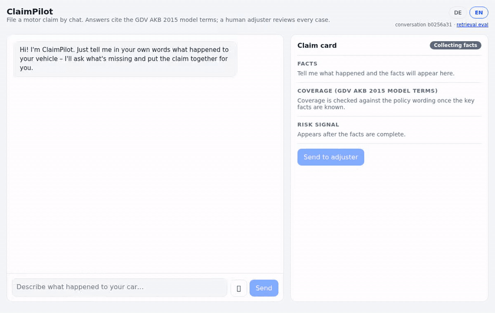

# InsureFlow AI — ClaimPilot

**File a motor insurance claim by talking to it.** One screen: a chat on the left, a live claim card on the right. An agent extracts the facts, asks for what is missing, checks coverage against the *real* policy wording with clause citations, scores fraud risk with a model trained on *real* claims, and hands the result to a human reviewer.

> Portfolio project by Parimal Gavali. Backend engineering + frontend engineering + applied AI, each backed by something you can open and read. Decision support only — nothing here approves, denies or accuses.

**Status:** v2 in progress. The v1 prototype is archived under [`legacy/`](legacy/README.md) (tag `v1-guidewire-prototype`). Current step: see [docs/ROADMAP.md](docs/ROADMAP.md).

---



*Recorded 2026-10-28 against live Claude (haiku 4.5), real Postgres/pgvector; one turn was enough because the model read the date from "last night". The project is not hosted — run it with `make demo` (below) or see `deploy/space/` to self-host on a Hugging Face Space.*

## What it does

Real transcript (German input, recorded LLM responses; `make e2e` replays exactly this):

```
You:   Gestern Abend hat jemand mein geparktes Auto auf dem Supermarktparkplatz in Köln
       angefahren und ist einfach weggefahren. Die hintere Stoßstange ist eingedrückt.
Agent: Das tut mir leid. Damit ich den Fall einordnen kann: Wann genau ist das passiert,
       und wurde die Polizei informiert?
You:   Das war am 25.10.2026 gegen 19 Uhr. Die Polizei habe ich nicht gerufen, Zeugen gab es keine.
Agent: Nach den Musterbedingungen ist ein Unfallschaden am eigenen Fahrzeug in der Vollkasko
       versichert [A.2.2.2.2]; dazu zählt auch, wenn ein Unbekannter Ihr geparktes Auto
       beschädigt. Ihre vereinbarte Selbstbeteiligung wird abgezogen [A.2.5.8]. Bitte beachten
       Sie Ihre Pflichten im Schadenfall: Schaden innerhalb einer Woche anzeigen [E.1.1.1] und
       alles zur Aufklärung beitragen [E.1.1.3]. Ein Sachbearbeiter prüft den Fall.
Card:  hit_and_run · Köln · 2026-10-25 19:00 · third party unknown · police report: no
       Coverage: likely covered (4 cited clauses, click to read)   Risk: low (model hgb-v1)
       Please provide: Polizeibericht/Anzeigenummer, Fotos, Kostenvoranschlag
       [Send to adjuster] → status "Awaiting adjuster"
       [Record adjuster review] (authorized reviewer) → status "Reviewed"
```

Every sentence above maps to a component:

| Piece | What is behind it |
| --- | --- |
| Follow-up questions | A **LangGraph** state graph with a conditional loop: `extract → check_missing → ask / continue` |
| Coverage with citations | **RAG** over the GDV *Allgemeine Bedingungen für die Kfz-Versicherung (AKB 2015)* — real German motor policy wording, clause-chunked, embedded with a multilingual transformer, stored in **pgvector** |
| Risk signal with reasons | A **scikit-learn** gradient-boosting model trained on 15,420 real vehicle claims (Kaggle vehicle-insurance-fraud, CC0), evaluated as an imbalanced problem (AUPRC, recall at fixed precision), with per-prediction feature contributions |
| "Send to adjuster" | Separate LangGraph pauses for customer submission and **human review**; the conversation state is checkpointed in Postgres |
| The LLM | Anthropic Claude via a provider interface; **Ollama** fallback so the demo runs offline |
| Bilingual | Corpus is German, UI is English, user may write either; multilingual embeddings handle DE↔EN retrieval |

## Architecture

```
Browser — Vue 3 single page (chat + claim card)
   │ HTTP + Server-Sent Events
   ▼
FastAPI ─── LangGraph agent (in-process) ─── LLM provider (Anthropic | Ollama)
   │              │              │
   │              │              └── fraud model artifact (.joblib) + explainer
   │              └── retriever ──► Postgres + pgvector (policy_chunks)
   └── SQLAlchemy ───────────────► Postgres (conversations, messages, claims, checkpoints)
```

Three containers: `db`, `api`, `web`. Details in [docs/ARCHITECTURE.md](docs/ARCHITECTURE.md).

## Data

Real, public, documented in [docs/DATA.md](docs/DATA.md):

- **GDV AKB 2015** — German Insurance Association model motor policy terms (RAG corpus)
- **Vehicle Insurance Fraud Detection** — 15,420 labelled real claims, CC0 (fraud model)
- **freMTPL2freq / freMTPL2sev** — 678k real French motor TPL policies, CC0 (realistic policyholder seed data)
- **InsuranceQA** — real consumer Q&A (RAG evaluation)

No real policy/claim data is linked across these sources publicly, so a thin seed layer joins them for the demo. That limitation is stated, not hidden.

## Repository layout

```
api/        FastAPI app (routers, SSE), LangGraph agent (api/agent), LLM providers (api/llm)
rag/        AKB chunking, embeddings, pgvector store, retriever, query rewriting, eval set
ml/         fraud-risk model: features, train, evaluate, explain, predict, model card, artifact
db/         SQLAlchemy models + Alembic migrations (policy chunks, conversations, checkpoints)
web/        Vue 3 single-page frontend, Vitest unit tests, Playwright e2e smoke
scripts/    fetch_data.py (AKB / OpenML / Kaggle), seed sampler, demo.sh
docs/       DECISIONS, DATA, ARCHITECTURE, ROADMAP, specs/, portfolio/, planning/
legacy/     archived v1 (not maintained)
```

## Running it

**Live demo:** https://huggingface.co/spaces/parimalgavali/claimpilot (free Space — first load after idle takes ~1 min).
Deployed from `main` by `.github/workflows/deploy-space.yml`: one container (`deploy/space/Dockerfile`) serving the API and the
built frontend, Postgres+pgvector on Neon, secrets in the Space settings. No GitHub Pages: the backend, database and embedding
model need a server.


One command (needs [uv](https://docs.astral.sh/uv/) and Docker):

```bash
git clone https://github.com/parimalgavali/insureflow-ai && cd insureflow-ai
make demo        # fetches public data, ingests the AKB into pgvector, starts db + api + web
open http://localhost:8080
```

`scripts/demo.sh` uses recorded LLM replies by default so it works without any key; export
`ANTHROPIC_API_KEY` before running it for live Claude. With Kaggle credentials
(`KAGGLE_USERNAME`/`KAGGLE_KEY` or `~/.kaggle/kaggle.json`) it retrains the fraud model;
otherwise it uses the committed `ml/artifacts/fraud_model.joblib` (210 KB, reproducible via
`python -m ml.train`).

Development (local Postgres 16 + pgvector, `DATABASE_URL` defaults to `claimpilot/claimpilot@localhost`):

```bash
uv sync --all-extras && (cd web && npm install)
uv run python scripts/fetch_data.py all     # AKB PDF→text, freMTPL2, seed policyholders (+ Kaggle if creds)
uv run alembic upgrade head && uv run python -m rag.ingest
make dev                                    # API :8000 (recorded LLM) + Vite :5173
make test && make lint                      # 66 pytest + 8 vitest, ruff, vue-tsc
make e2e                                    # Playwright smoke: full conversation → adjuster review
uv run python -m rag.eval                   # retrieval eval, fails below 0.8 top-3
uv run python -m api.agent.demo             # live Anthropic run of the hit-and-run script
```

Demo auth: the API requires a bearer token from `DEMO_API_TOKEN` and refuses to start without one, unless
`ALLOW_OPEN_API=1` is set (local dev only; `make dev`, pytest and the e2e set it). Claim review
(`POST /api/claims/{id}/review`) needs the separate `ADJUSTER_API_TOKEN` and is off when it is unset;
open **Reviewer queue** and enter it there (`make dev` uses `local-adjuster`). The queue keeps the
credential only in memory until you lock it or leave that screen; it never writes it to browser
storage. Customer submission never asks for a reviewer credential. Uploads are
limited to JPEG/PNG/WebP/PDF ≤ `MAX_UPLOAD_MB` (10). `.env` is git-ignored; only `.env.example` is committed.

Reviewers can also **Request information** with a note. The customer sees **Information needed**,
replies in chat, and submits the refreshed claim again. Recorded demo mode uses the original
hit-and-run replies plus a labeled synthetic follow-up turn for this request/reply path.

Reviewer fact edits use **Save corrections and refresh** before a separate final review.
If coverage or risk cannot be refreshed, corrections stay saved, guidance is labeled
**Out of date**, and completion is blocked until **Retry assessment** succeeds.

The claim card also shows a saved history of submissions, reviewer requests, corrections and
completed reviews. **Open saved history** provides a link that survives a reload. Entries show
server-recorded times and the available demo access role; they do not identify a named reviewer
when a shared credential was used. Earlier activity may not be available.

Customers can use **Edit facts** before submission. Missing details remain visible;
invalid dates or negative amounts show simple explanations. Saving complete details
refreshes coverage and risk before submission. If that refresh fails, the changes
stay saved and **Retry assessment** must succeed before the claim can be sent.

### Measured numbers

RAG over AKB 2015 — 28 hand-written DE/EN questions, hit if the expected clause is in the top 3
(`rag/eval/questions.jsonl`, run in CI):

| retrieval | top-1 | top-3 | DE top-3 | EN top-3 |
|---|---|---|---|---|
| multilingual-e5-small, dense only | 0.61 | 0.71 | 0.83 | 0.50 |
| + LLM query rewriting into German policy language | 0.61 | **0.89** | 0.89 | 0.90 |

Fraud-risk model — 15,420 real claims, 6% positive, held-out 20% (`ml/model_card.md`):

| model | AUPRC | ROC-AUC |
|---|---|---|
| majority class | 0.060 | 0.500 |
| logistic regression | 0.167 | 0.805 |
| HistGradientBoosting (`hgb-v1`) | **0.205** | **0.813** |

The model uses only features a conversation can supply and excludes protected attributes; it
ranks claims for adjuster attention and is never shown as a verdict.

Data cards with licenses and checksums: [`data/README.md`](data/README.md). Decisions and
measured alternatives: [`docs/DECISIONS.md`](docs/DECISIONS.md). Resume bullets and interview
Q&A: [`docs/portfolio/`](docs/portfolio/README.md).

## Why v2 exists

v1 (June–July 2026) was a wide Guidewire-style scaffold — 9 containers, 5 pages, 20 phases — on synthetic data, with "AI" components that were keyword matching and regexes. The audit and the reasoning for the reset are in [docs/planning/2026-10-27-v2-direction.md](docs/planning/2026-10-27-v2-direction.md) and [docs/DECISIONS.md](docs/DECISIONS.md). Narrow and real beats wide and shallow.

## Responsible AI

Outputs are decision support for a human reviewer. The fraud signal is a *risk score with reasons*, never a verdict. Coverage answers always cite the clause and say when evidence is missing. Everything runs on public data; nothing personal is stored beyond a demo conversation.

## License

MIT for the code. Data sources keep their own licenses (see docs/DATA.md).

Risk signals require a known incident date/type, third-party involvement, police/witness answers, and valid policy settings. Collisions with another party also require whether that party is known. Missing answers show **Not enough information** with the needed details; they never produce a low-risk badge. This remains guidance for human review, with model assumptions documented in [the model card](ml/model_card.md).

Message retries retain the original text and attachment on the current page. A stable operation ID lets the server replay saved responses or resume an interrupted assessment without saving another message or upload. New messages and claim edits wait until the unfinished message is recovered. Refreshing restores the current conversation, claim status and saved messages using only a locally saved conversation ID. Unfinished messages can resume from their saved server input after reload. Credentials stay in memory and must be entered again when access is required. Use **Start new claim** to create another conversation without deleting the old one.

Claim attachments show their filename, purpose, actual format and processing state to customers and reviewers. Choose **Damage photo**, **Repair estimate**, **Police report** or **Other document** before sending. Files are checked for matching type and readable contents before saving. Only a verified image labelled as a damage photo automatically sets **Photos attached**; a PDF or image of a report does not. Stored files are labelled **Uploaded. Not yet analysed for claim details.** Older uploads remain unverified. Rejected uploads return the message to the draft so you can replace or remove the file. See [attachment handling](docs/specs/us-16-evidence-types.md) for limits and verification details.

Use **Read claim PDF** to suggest details from readable claim PDFs. Each suggestion shows the document, page and supporting quote, and remains separate from confirmed claim facts. Reading a PDF does not change coverage, risk or review status. Scans need a selectable-text version; text extraction is limited to 40,000 characters per document. See [PDF evidence suggestions](docs/specs/us-17-evidence-suggestions.md) for scope and retry behavior.

Compare each document suggestion with its **Saved value**, then accept or reject it individually. Replacing a conflicting saved value needs a separate confirmation checkbox. Accepted changes use the existing assessment refresh; if that refresh fails, the changed fact stays saved and submission waits for a successful refresh. Decisions and source pages appear in history. An interrupted confirmation can be finished after reload without applying it twice. See [confirming document suggestions](docs/specs/us-18-confirm-evidence.md).

If a claim PDF cannot be read, the app explains whether it is empty, has no selectable text, is damaged or is password-protected. Use **Enter details yourself** or **Replace PDF copy**. Earlier copies stay visible as previous versions; their pending suggestions cannot be applied. Replacing a copy keeps the rest of the claim and starts the new copy as unread. See [unreadable documents and replacements](docs/specs/us-19-evidence-replacement.md).

The **Document checklist** shows **Missing**, **Uploaded — awaiting reviewer check**, or **Confirmed by reviewer**. It follows saved file links and current versions; an upload, a checked fact or a policy PDF does not prove that requested claim evidence is sufficient. Customers can link/unlink files, and reviewers can request specific documents and confirm the exact copies they checked. Replacements need a fresh check. See [the saved document checklist](docs/specs/us-20-document-checklist.md).

Policy PDFs have a separate upload panel and saved filename. Unencrypted PDFs with 1–300 pages are accepted within MAX_UPLOAD_MB (10 MB by default). The initial status is **Uploaded; awaiting text preparation**. Use **Prepare policy text** to save page-referenced, searchable passages. Empty, encrypted and unreadable policies show a failed status and can be retried. Preparation runs in a bounded worker and becomes ready only after passages are saved. When a policy is selected, coverage searches use only that policy. Citations show its filename, page and supporting passage. Unprepared or missing wording leads to an explicit gap and human review, with no silent demo fallback. Standard GDV AKB 2015 wording is used only when no policy is selected. Source changes mark older assessments out of date and block finalization until refreshed. Policy uploads do not count as claim evidence. Use sample documents in the shared demo.

Before submission, **Replace policy** asks you to confirm the selected filename. A replacement creates a new current revision while retaining earlier versions. Prepare the new text and refresh the assessment; previous guidance stays out of date until both steps succeed. Failed preparation does not reuse superseded wording. Competing changes are rejected if the current selection no longer matches the confirmed version. Migration 0008 enables versioned storage; its downgrade refuses to discard retained versions automatically.

Policy-search separation is enforced by conversation and current document ID, including retained revisions and cached replies. Citations are returned inside the authenticated claim/conversation response; there is no unauthenticated passage-download route. This is still a shared demo: a valid demo credential can read saved claims by ID, and ALLOW_OPEN_API=1 explicitly opens access. Conversation filtering prevents policy mixing; it does not provide private user accounts or ownership-based authorization.

Repeatable claim-type checks cover collision, theft, glass, vandalism and storm/hail using recorded responses and a fictional selected policy. Run `uv run pytest tests/test_claim_scenarios.py` with the test database configured. See [scenario fixtures](tests/fixtures/claim_scenarios/README.md) and [verification scope](docs/specs/us-21-claim-scenarios.md).
